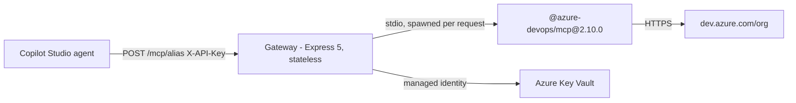
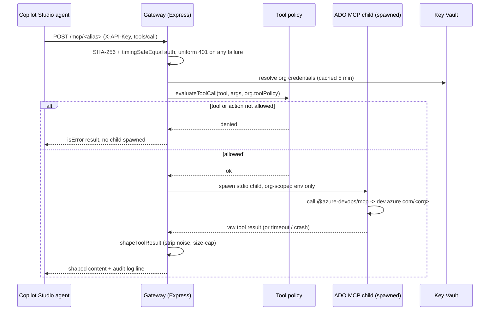
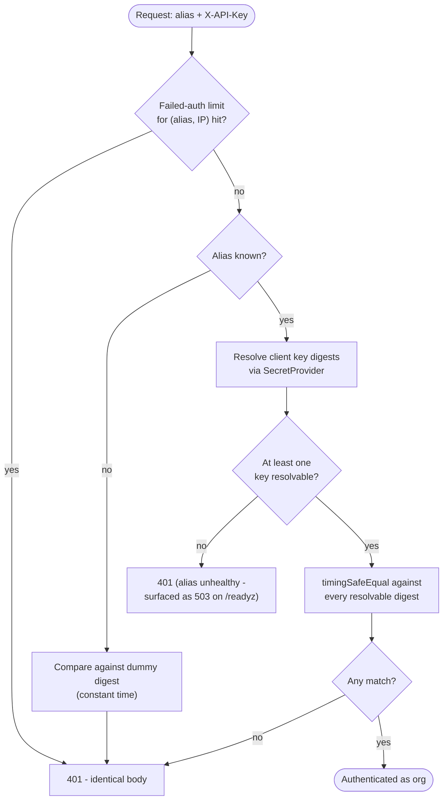
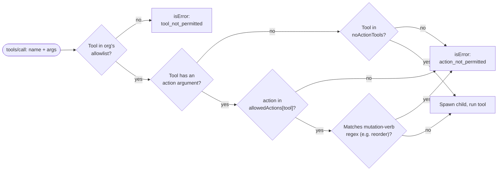
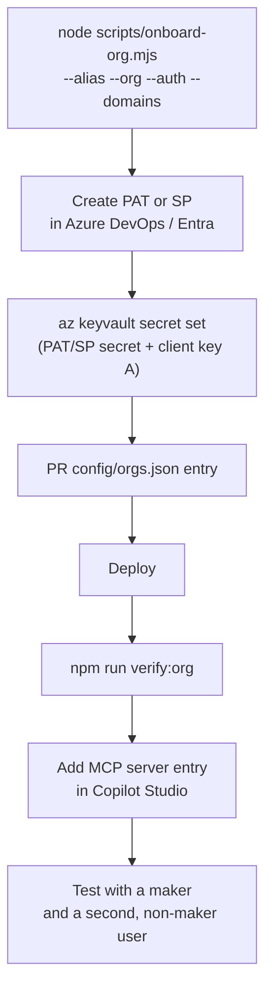
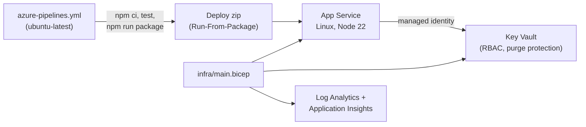

# ADO MCP Gateway


**ADO MCP Gateway is a multi-tenant MCP server for Microsoft Copilot Studio that turns one Azure DevOps organization per client into a read-only, policy-enforced tool endpoint** - so a single App Service deployment can safely serve many ADO orgs without handing agents write access, shared credentials, or ADO's full MCP tool surface.



> One deployment, many orgs: each Copilot Studio agent hits its own `/mcp/<alias>` route with its own key, credentials, and tool limits - nothing about one org is visible to another.

## Table of contents

- [ADO MCP Gateway](#ado-mcp-gateway)
  - [Table of contents](#table-of-contents)
  - [Who it's for](#who-its-for)
  - [Features](#features)
  - [Quick start (local)](#quick-start-local)
  - [How it works](#how-it-works)
    - [Request lifecycle (sequence)](#request-lifecycle-sequence)
    - [Auth decision flow](#auth-decision-flow)
    - [tools/call policy evaluation](#toolscall-policy-evaluation)
  - [Configuration](#configuration)
    - [Environment variables](#environment-variables)
    - [Org registry (`config/orgs.json`)](#org-registry-configorgsjson)
    - [Tool policy (`config/tool-policy.json`)](#tool-policy-configtool-policyjson)
  - [Security](#security)
    - [Threat model](#threat-model)
    - [Residual risks (known)](#residual-risks-known)
  - [Onboarding a new org](#onboarding-a-new-org)
  - [Failure modes](#failure-modes)
  - [Scripts](#scripts)
  - [Deploy / Infrastructure](#deploy--infrastructure)
  - [Tech stack](#tech-stack)
  - [Project structure](#project-structure)
  - [Extending / API](#extending--api)
  - [Observability](#observability)
  - [FAQ](#faq)
  - [Contributing](#contributing)
  - [License](#license)

## Who it's for

Teams running Microsoft Copilot Studio agents that need to read from Azure DevOps - work items, repositories, pipelines, wikis, test plans - across several organizations, without exposing raw PATs, service-principal secrets, or ADO's full (write-capable) MCP tool surface to the agent. One gateway instance fronts every org; each org gets its own alias, client keys, credential source, and tool limits, and none of that ever leaves its own request path.

## Features

| Feature | What it does |
| --- | --- |
| **Per-org routing** | Each org is an alias (`/mcp/<alias>`) with its own API keys, ADO credentials, domains, and rate limits, defined in `config/orgs.json` and validated against a Zod schema |
| **Default-deny tool policy** | Only tools and **actions** explicitly listed in `config/tool-policy.json` are reachable; anything new after an `@azure-devops/mcp` upgrade is rejected until reviewed |
| **PAT or service-principal auth** | Each org authenticates to ADO with either a PAT or an Entra service principal (tenant + client ID + secret), resolved through a pluggable `SecretProvider` |
| **Key Vault in production, env in dev** | `KeyVaultSecretProvider` (managed identity, 5-minute cache) is required in production; `EnvSecretProvider` is dev-only and rejected outside `development`/`test` |
| **Uniform auth failures** | Unknown alias, missing key, and wrong key all return an identical 401 body, with a dummy digest compare so timing doesn't leak which case occurred |
| **Failed-auth throttling before the key check** | 20 failed requests/minute per (alias, IP); unknown aliases share one bucket; a correct key past the limit is still refused |
| **Spawn-per-call isolation** | Each `tools/call` spawns an isolated `@azure-devops/mcp` child with only that org's credentials in its environment, capped by a concurrency pool and a hard timeout |
| **Response shaping** | Strips ADO noise (`_links`, avatars, plan/trigger internals), collapses identity and project objects, preserves the `UNTRUSTED` envelope used to mark model-facing text, and size-caps at `maxResponseChars` |
| **Drift and security verification** | `scripts/verify/*` check live tool/action drift, secret leakage, auth/throttle behavior, and Azure readiness before every deploy |

## Quick start (local)

```bash
cp .env.example .env.local   # fill SECRET__* values; never commit
npm ci
npm run build
npm run dev
```

`npm run dev` runs the gateway with `tsx watch` against `config/orgs.json` (start from `config/orgs.example.json`, which has one PAT-auth org and one service-principal org). Before trusting a change, also run:

```bash
npm test               # Vitest unit + integration suite
npm run verify:local   # local smoke checks (build, start, basic calls)
```

## How it works

### Request lifecycle (sequence)



### Auth decision flow



### tools/call policy evaluation



Design rationale for every one of these choices (spawn-per-call vs. a long-lived child, Key Vault vs. app settings, uniform 401, default-deny over default-allow) is recorded as a decision table in [`docs/ARCHITECTURE.md`](docs/ARCHITECTURE.md) and `.cursor/rules/10-architecture.mdc`.

## Configuration

### Environment variables

| Variable | Default | Notes |
| --- | --- | --- |
| `NODE_ENV` | `development` | `development` \| `test` \| `production`. Production forces Key Vault. |
| `PORT` | `8080` | HTTP listen port |
| `ORG_REGISTRY_PATH` | `config/orgs.json` | Path to the org registry, validated against `orgEntrySchema` |
| `KEY_VAULT_URI` | - | **Required** when `NODE_ENV=production` |
| `CHILD_TIMEOUT_MS` | `60000` | Hard timeout per spawned `@azure-devops/mcp` child |
| `MAX_CONCURRENT_CHILDREN` | `6` | Concurrency cap across all orgs |
| `QUEUE_TIMEOUT_MS` | `10000` | How long a call waits for a free child slot before a clean "busy" error |
| `ADO_MCP_BIN` | - | Override binary, e.g. `test/fixtures/fake-ado-mcp.mjs` for tests |
| `APPLICATIONINSIGHTS_CONNECTION_STRING` | - | Optional App Insights wiring |
| `SECRET__<NAME_UPPER_SNAKE>` | - | Dev-only: `EnvSecretProvider` maps this to the Key Vault secret name it stands in for |

### Org registry (`config/orgs.json`)

Each entry is validated with a strict Zod schema (`orgEntrySchema`) - unknown fields are rejected outright:

| Field | Constraint | Purpose |
| --- | --- | --- |
| `alias` | `^[a-z0-9][a-z0-9-]{1,30}$` | URL path segment: `/mcp/<alias>` |
| `adoOrg` | `^[A-Za-z0-9][A-Za-z0-9-]{0,49}$` | The Azure DevOps organization name |
| `domains` | non-empty array of known domains | See domain table below |
| `auth` | `{ type: "pat", secret }` or `{ type: "entra-sp", tenantId, clientId, secret }` | Discriminated union; `secret` is a Key Vault **secret name**, never a value |
| `clientKeys` | 1-2 secret names | Supports A/B key rotation with no restart |
| `toolPolicy.extraAllow` / `extraDeny` | string arrays | Per-org narrowing; **cannot** enable a write-named tool globally denied |
| `limits.ratePerMinute` | default `120` | Per-org request rate |
| `limits.maxResponseChars` | default `60000` | Response shaping size cap |
| `instructions` | optional string | Injected as MCP server instructions for that org, e.g. "call `core_list_projects` first" |

Supported `domains`: `core`, `work`, `work-items`, `search`, `test-plans`, `repositories`, `wiki`, `pipelines`, `advanced-security`.

### Tool policy (`config/tool-policy.json`)

Single source of truth for what the gateway will ever call on ADO's behalf, read by `src/ado/toolPolicy.ts` and checked by `scripts/verify/tool-drift.mjs`:

- **`allowedActions`** - per-tool allowlist of specific actions (e.g. `pipelines_build`: `list`, `get_status`, `get_changes`). Everything not listed is denied.
- **`noActionTools`** - tools with no `action` argument that are allowed outright (`core_list_projects`, `core_list_project_teams`, `repo_search_commits`).
- **`reviewedBlockedActions`** - actions seen and deliberately kept blocked, e.g. `wit_backlog.reorder` (a write hiding behind a read-shaped tool).

Currently allowed domains cover pipelines (list/status/changes/logs/definitions/runs), repos (repository/PR/thread/branch/file, read-only), work items (get/batch/comments/my/revisions/iteration/type, plus WIQL queries), and wiki (list/get wikis and pages).

## Security

This gateway exists specifically to keep ADO write access, PATs, and service-principal secrets away from the agent, so security is load-bearing, not incidental.

- **Secrets never sit in app settings.** Production reads only from Key Vault via managed identity; `EnvSecretProvider` is dev-only and refuses to run outside `development`/`test`.
- **Default-deny tools.** `extraAllow` in an org's config cannot enable a write-named tool; a blocked write action (`wit_backlog.reorder`) stays blocked even after an `@azure-devops/mcp` upgrade, until a human reviews it.
- **Cross-org isolation.** Each spawned child gets only its own org's credentials in its process environment - never another org's, never the gateway's own admin key.
- **Constant-time auth.** Keys are compared as SHA-256 digests with `timingSafeEqual`, always against at least one digest (a dummy one if none resolve), so timing doesn't reveal alias validity or key correctness.
- **Redaction and generic errors.** Logs never contain secrets or result bodies (pino redact); anything not written by the gateway itself is replaced with a generic message plus a `requestId`, with detail only in the server log.
- **Body and concurrency limits.** 256 KB request bodies, per-org rate limits, and a bounded child pool with a queue timeout guard against flooding.

### Threat model

| Asset | Threat | Control |
| --- | --- | --- |
| Client API key | Leak / reuse across orgs | Per-alias keys, uniform 401, Key Vault storage |
| PAT / SP secret | Leak via logs or app settings | Never in app settings; redaction; `EnvSecretProvider` banned in prod |
| Prompt injection via ADO text | Agent follows ticket/PR text | `UNTRUSTED` envelope preserved through shaping; read-only tools; allowlist |
| Tool drift after upgrade | New write tool/action appears | Default-deny + explicit action allowlist; `extraAllow` can't enable write tools; `verify:drift` fails on unreviewed actions |
| Alias enumeration / key guessing | Probe aliases, brute-force keys | Identical 401; failed-request limiter checked *before* the key; unknown aliases share one bucket |
| SSRF | User-controlled URLs | Fixed ADO host in the official server; no user-supplied URLs |
| DoS | Flood / huge bodies | 256 KB body cap, rate limits, child concurrency cap |
| Log leakage | Secrets in stdout | pino redact; no result bodies logged |
| Supply chain | Bad package / wrong arch | Pinned lockfile, npm audit, Linux ELF check in `verify:package` |
| Key Vault compromise | Blast radius | Per-org secrets; RBAC Secrets User scoped to the managed identity only |
| Cross-org bleed | Wrong credentials reaching a request | Per-request child env; covered by integration tests |

### Residual risks (known)

- **Shared service identity:** every user of a given Copilot Studio agent sees whatever that org's PAT/SP can see in ADO - least privilege lives in ADO project membership, not per end user.
- **Copilot Studio connection scope:** connections are user-scoped per Microsoft's docs; end users may be prompted for the API key. Test with a second, non-maker account before rollout.
- **Global PATs stop working 2026-12-01** - every PAT must be scoped to one specific organization.
- **A known alias with no loadable client keys returns 503, not 401** - intentional, so operators see a real outage, but it does mean the alias itself isn't secret.
- **The failed-request limiter is per source IP.** Copilot Studio calls come from shared Microsoft ranges, so a badly misconfigured client could briefly throttle other callers on the same address for that alias (limit: 20 failed requests/minute).
- **Rotation latency:** a rotated or revoked client key takes effect within the Key Vault cache TTL (5 minutes), not instantly; restart the app to force it sooner.
- **No per-user OAuth on-behalf-of yet** - the authenticator interface is ready for it, but every call currently runs as the shared org identity.

Full write-up, including proof/evidence per control: [`docs/SECURITY.md`](docs/SECURITY.md).

## Onboarding a new org



Detailed, step-by-step version (including the ADO-side least-privilege setup - service account, Readers group, scoped PAT) lives in [`docs/ONBOARD-NEW-ORG.md`](docs/ONBOARD-NEW-ORG.md) and [`PREREQUISITES.md`](PREREQUISITES.md). Copilot Studio-specific wiring (header name, test plan, what to check for a second user) is in [`docs/COPILOT-STUDIO.md`](docs/COPILOT-STUDIO.md).

## Failure modes

| Failure | Client sees | Recovery |
| --- | --- | --- |
| Wrong API key | Identical 401 | Rotate / use key-b |
| Missing org secret | 503 for that alias only | Put the secret in Key Vault |
| Child hang | Tool error after `CHILD_TIMEOUT_MS` | Automatic kill + reap |
| Upstream ADO 401 / HTML error page | Tool error, no body leaked | Fix PAT scopes / identity |
| Tool drift after upgrade | CI `verify:drift` fails | Review the new action; add to `allowedActions` or `reviewedBlockedActions`, then refresh the snapshot |
| Pool at capacity | "Gateway busy" after `QUEUE_TIMEOUT_MS` | Increase `MAX_CONCURRENT_CHILDREN` or retry |

## Scripts

| Script | Purpose |
| --- | --- |
| `npm run dev` | Run the gateway locally with file watching (`tsx watch`) |
| `npm run build` / `npm start` | Compile to `dist/` and run the compiled server |
| `npm test` | Run the Vitest unit and integration suite |
| `npm run lint` / `npm run typecheck` | ESLint and `tsc --noEmit` |
| `npm run verify:local` | Local smoke checks before pushing; continues past a failed step and reports spawn errors |
| `npm run verify:org` | Probe a live org's credentials and enabled domains |
| `npm run verify:security` | Auth, throttle, tools/list, `reorder`-block, and error-leak checks |
| `npm run verify:azure` | Azure / App Service preflight |
| `npm run verify:secrets` | Scan for accidentally committed secrets |
| `npm run verify:drift` | Diff the live tool/action list against `config/tool-policy.json` (`-- --update` refreshes the snapshot after a reviewed change) |
| `npm run verify:soak` | Sustained-load check |
| `npm run verify:prereq` | Confirms local/CI prerequisites are met |
| `npm run verify:package` | Real smoke start of the packaged zip; Linux ELF check |
| `npm run onboard` | Scaffold a new org entry (`scripts/onboard-org.mjs`); runs `npm run build` first |
| `npm run package` | Build the deployable Linux zip (deflate-compressed, stable timestamps) |

## Deploy / Infrastructure

Target runtime is **Azure App Service (Linux, Node 22)**, `node dist/index.js`, deployed as a Run-From-Package zip built by `npm run package`. CI **must** run on `ubuntu-latest` - the zip contains native Linux binaries.



Infrastructure (Log Analytics, Application Insights, Key Vault with RBAC, and the App Service with an optional staging slot) is defined in [`infra/main.bicep`](infra/main.bicep):

```bash
az group create --name rg-adomcp-dev --location centralindia

az deployment group what-if \
  --resource-group rg-adomcp-dev \
  --template-file infra/main.bicep \
  --parameters infra/main.parameters.example.json

az deployment group create \
  --resource-group rg-adomcp-dev \
  --template-file infra/main.bicep \
  --parameters infra/main.parameters.example.json
```

After deploy, grant yourself **Key Vault Secrets Officer** on the vault manually (not scripted in Bicep). App settings carry no secrets - only `KEY_VAULT_URI`, `NODE_ENV`, `ORG_REGISTRY_PATH`, `CHILD_TIMEOUT_MS`, `MAX_CONCURRENT_CHILDREN`, `APPLICATIONINSIGHTS_CONNECTION_STRING`, `WEBSITE_RUN_FROM_PACKAGE`, and `SCM_DO_BUILD_DURING_DEPLOYMENT`. Set `alertEmail` in the parameters file or the built-in 5xx/health/401-spike alerts notify nobody. See [`infra/README.md`](infra/README.md) for the bootstrap (Oryx-build) path, staging-slot swaps, and network hardening notes.

## Tech stack

- **Runtime:** Node.js >=22, TypeScript 5.8, ES modules
- **Server:** Express 5, Helmet, express-rate-limit
- **MCP:** `@modelcontextprotocol/sdk` (Streamable HTTP transport), `@azure-devops/mcp@2.10.0` (spawned per call)
- **Azure:** `@azure/identity`, `@azure/keyvault-secrets`
- **Validation / schema:** Zod, `zod-to-json-schema` (emits `config/orgs.schema.json` for editor support)
- **Logging:** Pino, with secret redaction
- **Testing:** Vitest (unit + integration), a fake ADO MCP fixture for isolated tests
- **Tooling:** ESLint (typescript-eslint), Prettier

## Project structure

```
Cursor-mcp/
├── src/
│   ├── index.ts             # entrypoint: env, registry, secrets, server lifecycle, graceful shutdown
│   ├── http/app.ts          # Express app: helmet, auth, rate limits, /healthz, /readyz, MCP route
│   ├── mcp/gateway.ts       # tools/list + tools/call handlers, tool cache, response logging
│   ├── ado/
│   │   ├── child.ts         # spawns @azure-devops/mcp per call, concurrency pool, timeout
│   │   ├── credentials.ts   # resolves PAT / service-principal credentials for a child's env
│   │   ├── shape.ts         # strips ADO noise, preserves UNTRUSTED envelope, size-caps
│   │   └── toolPolicy.ts    # evaluates tool/action allowlist + mutation-verb guard
│   ├── auth/clientAuth.ts   # per-alias API key authentication (SHA-256 + timingSafeEqual)
│   ├── config/
│   │   ├── env.ts           # Zod-validated environment schema
│   │   └── registry.ts      # org registry schema, alias/adoOrg/secret-name validation
│   ├── secrets/
│   │   ├── provider.ts      # SecretProvider interface
│   │   ├── env.ts           # EnvSecretProvider (dev only)
│   │   └── keyvault.ts      # KeyVaultSecretProvider (managed identity, cached)
│   └── observability/logger.ts   # Pino logger with redaction
├── config/                  # orgs.json (registry), orgs.example.json, tool-policy.json, tool-snapshot.json, orgs.schema.json
├── scripts/
│   ├── onboard-org.mjs      # scaffolds a new org entry
│   ├── package.mjs          # builds the deploy zip
│   ├── parity.mjs / test-client.mjs
│   └── verify/              # local, org, security, azure-preflight, secrets-scan, tool-drift, soak, prereq, package
├── infra/                   # Bicep: App Service, Key Vault, Log Analytics, App Insights
├── docs/                    # ARCHITECTURE, SECURITY, RUNBOOK, ONBOARD-NEW-ORG, COPILOT-STUDIO
├── test/
│   ├── unit/                # auth, credentials, registry, runCommand, secrets, shape, toolPolicy, smoke
│   ├── integration/         # http.test.ts, policy.test.ts
│   ├── helpers/testApp.ts
│   └── fixtures/            # fake-ado-mcp.mjs, sample pipeline list
├── legacy/start.mjs
├── PREREQUISITES.md
└── azure-pipelines.yml      # Linux CI: build, test, package
```

## Extending / API

- **Add an org:** `node scripts/onboard-org.mjs --alias <alias> --org <ado-org> --auth pat --domains <domains>`, store secrets in Key Vault, PR the `config/orgs.json` change, deploy, then `npm run verify:org`. Full steps, including least-privilege ADO setup: [`docs/ONBOARD-NEW-ORG.md`](docs/ONBOARD-NEW-ORG.md).
- **Wire up Copilot Studio:** one MCP server entry per org - header auth, `X-API-Key`, URL `https://<host>/mcp/<alias>` - see [`docs/COPILOT-STUDIO.md`](docs/COPILOT-STUDIO.md).
- **Upgrade `@azure-devops/mcp`:** bump the pinned version in `package.json`, run `npm run verify:drift`, and explicitly allow (`allowedActions`) or block (`reviewedBlockedActions`) any new action in `config/tool-policy.json` before deploying to staging. Full steps: [`docs/RUNBOOK.md`](docs/RUNBOOK.md).
- **Rotate a key, PAT, or SP secret; add/remove an org; roll back a deploy:** all covered as runbook procedures in [`docs/RUNBOOK.md`](docs/RUNBOOK.md).

## Observability

- **`/healthz`** - liveness.
- **`/readyz`** - readiness, including per-alias health (an alias with zero loadable client keys is unhealthy); admin key compared in constant time.
- **Structured logs (Pino):** every `tools/list` / `tools/call` logs `requestId`, `alias`, `method`, `tool`, `outcome` (`ok` / `denied` / `action_denied` / `busy` / `error` / `tool_error`), `durationMs`, and character counts - never result bodies or secrets.
- **Kusto query for App Service logs** (see [`docs/RUNBOOK.md`](docs/RUNBOOK.md)):

```kusto
AppServiceConsoleLogs
| where TimeGenerated > ago(1h)
| where ResultDescription has "mcp"
| project TimeGenerated, ResultDescription
```

- **Application Insights** wiring is optional via `APPLICATIONINSIGHTS_CONNECTION_STRING`; alerts (5xx, health check, 401 spike) are provisioned by Bicep but only notify someone if `alertEmail` is set.

## FAQ

**Why spawn a child process per call instead of one long-lived MCP client?** Isolation - each org's credentials only ever exist in the environment of the process handling that org's request, so nothing persists between calls or leaks across orgs.

**Is there a frontend?** No - this is a backend-only gateway; Copilot Studio (or any MCP-speaking client) is the caller.

**Are write operations possible?** No. The tool policy is default-deny at both the tool and action level, `extraAllow` cannot enable a write-named tool, and known write-like actions hiding behind read-shaped tools (like `wit_backlog.reorder`) are explicitly kept in `reviewedBlockedActions`.

**Where do secrets live?** Azure Key Vault in production, read via managed identity and cached for 5 minutes; never in App Service settings. Locally, `.env.local` (git-ignored) via `EnvSecretProvider`, which refuses to run outside `development`/`test`.

**What happens if a client key is rotated?** Nothing breaks - keys are re-read per request, so both the old and new key work until you remove the old one; no app restart required (though the Key Vault cache means up to 5 minutes of latency).

**Does one org ever see another org's data?** No - routing, credentials, rate limits, and tool policy are all resolved per-alias, and each tool call spawns a child scoped to exactly one org.

**Is there Docker support?** No - the project explicitly targets Run-From-Package on App Service Linux; Docker/containers are a stated non-goal.

## Contributing

There is no `CONTRIBUTING.md` yet. Work is driven through the Cursor kit under `.cursor/` (rules in `.cursor/rules/`, phased slash commands like `/gw-plan` and `/gw-phase-*` in `.cursor/commands/` - see `.cursor/README.md` for the full layout). Before opening a PR, run:

```bash
npm run lint
npm run typecheck
npm test
npm run verify:local
```

If your change touches `config/tool-policy.json` or upgrades `@azure-devops/mcp`, also run `npm run verify:drift` and update `config/tool-snapshot.json`.

## License

No `LICENSE` file is present in this repository - license TBD.